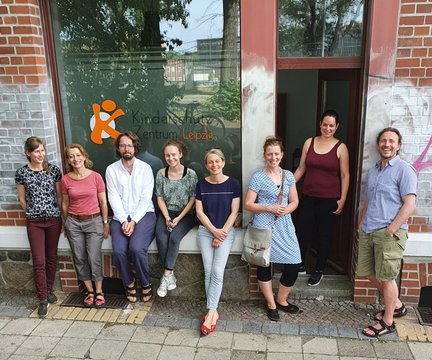

In der Bornaischen Straße 101 prangt seit einigen Wochen das Logo des Kinderschutz-Zentrums Leipzig. In den Räumen einer ehemaligen Schneiderei finden nun auch Erziehungs- und Familienberatungen statt und auch eine neue Kollegin dürfen wir dafür begrüßen.

Diese Erweiterung soll insbesondere den Kindern, Jugendlichen und Familien aus Lößnig eine Anlaufstelle bieten, wie immer gilt aber auch hier ihr Wunsch und Wahlrecht und Personen aus ganz Leipzig sind willkommen.

Die Anmeldung und der Kontakt finden weiterhin über das Büro in der Brandvorwerkstraße und die bekannten Telefonnummern und E-Mailadressen statt.

