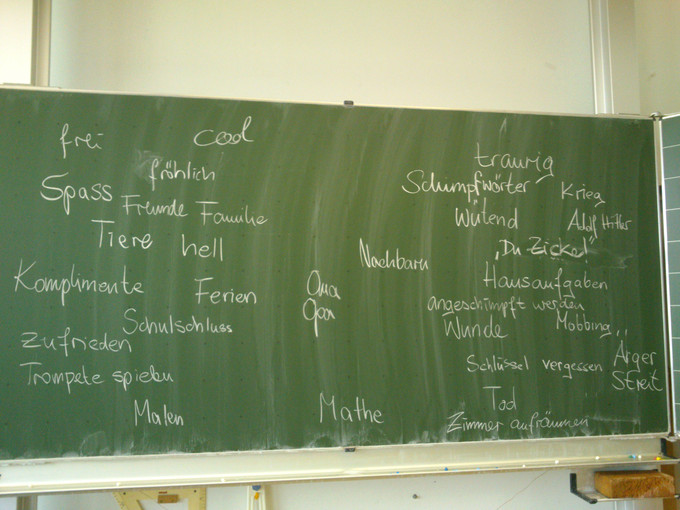

## Schwerpunkte der Projekte
In unserer Arbeit mit Grundschülern ist uns vor allem wichtig, einen Zugang zu den Themen Körper, Gefühle, Sexualität, Grenzen und Hilfe schaffen. Wir vermitteln, dass man auch über peinliche, schambehaftete oder unangenehme Themen und Erlebnisse reden kann. Dabei fördern wir sowohl Wissen als auch Handlungskompetenzen bezogen auf folgende Themen:

- Ich bin stark - Selbstbewusstsein und Selbstwertgefühl
- Gefühle - Unterscheidung von schönen und unangenehmen Gefühlen und die Wichtigkeit von beiden
- Berührungen - Beschäftigung mit der Frage: Wer darf mich wo, wann, wie berühren und wann ist eine Berührung für mich unangenehm?
- Nein-sagen - Stärkung in der Fähigkeit "Nein" zu sagen und Verständnis dafür, wie schwer dies gerade gegenüber Erwachsenen fällt
- Geheimnisse - Unterscheidung von guten und schlechten Geheimnissen und Umgang vor allem mit letzteren
- Hilfe - wo können sich Kinder Hilfe holen und wer sind die eigenen Lieblingsmenschen mit denen man auch über unangenehme Themen sprechen kann

## Ich bin stark - Projekttag
**Umfang**: Wir kommen für 5 Unterrichtsstunden in eine 3. oder 4. Klasse.

Vor dem Projekt erstellen wir einen Elternbrief zur Information über das Projekt.
Wir bieten ebenso einen passenden 1-1,5 stündiger Elternabend an (siehe [Angebote für Eltern](/angebote/praevention-fuer-eltern/))

**Methodik**: Wir arbeiten mit Spielen, Übungen, Bastelein, Arbeitsblättern, Geschichten, Comics oder Videos und im freien Unterrichtsgespräch. Wir kommen im Frau-Mann-Team, um den Kindern positive Vorbilder und manchmal auch eine Verwirrung im Bezug auf Geschlechterrollen zu ermöglichen.

**Kosten**: 2€ Materialkosten pro Schüler\*in, per Quittung oder auf Rechnung

**Verfügbarkeit**: Melden Sie sich ab Juni für Projekte im darauffolgenden Schuljahr

**Sonstiges**: Die Begleitung der Stunden durch die Klassenlehrer\_in ist unbedingt erwünscht und sie\_er wird auch gern von uns in die Gespräche mit eingebunden.

## Starke Kids - Hortprojekt
**Umfang**: Für dieses Projekt kann es im Umfang eine Anpassung je nach Bedarf der Gruppe geben. In der Regel kommen wir fünf bis sechs Mal im wöchtenlichen Abstand für 1-1,5 Stunden in den Hort und arbeiten mit einer festen Kindergruppe von bis zu 12 Kindern.

Es findet ein Vor- und Nachgespräch mit der verantwortlichen Erzieher\_in statt.

**Methodik**: Wir arbeiten mit Spielen, Übungen, Bastelein, Geschichten, Comics oder Videos und im freien Gespräch.

**Kosten**: Es fallen keine Kosten an. Dafür wird beim Material stark auf den Hort-Bestand zurückgegriffen und die Erzieher\_in auch in der Durchführung eingebunden.

**Verfügbarkeit**: Eine Umsetzung bedarf in der Regel mindestens 1 Monat Vorlauf.

**Sonstiges**: Für einige Projektstunden benötigen wir zwei Räume zum Arbeiten in getrennten Gruppen.

## Spiele, die mutig machen - Ganztagsangebot
**Umfang**: Dieses Angebot richtet sich an Kinder, die im Zusammensein mit anderen unsicher, schüchtern und zurückhaltend sind, die andere über ihre Grenzen gehen lassen und denen es schwer fällt, für ihre eigenen Bedürfnisse einzustehen.

Im wöchentlichen Abstand findet im Nachmittag das Angebot für 1-1,5 Stunden statt. Pro Halbjahr wird mit einer Gruppe von acht bis zehn Kindern der 2. und 3. Klasse gearbeitet - das ergibt 10-15 Termine pro Gruppe.

**Methodik**: Wir arbeiten mit vielen Spielen, Übungen, Bastelein, Geschichten, Comics oder Videos aber auch mit Arbeitsblättern, Entspannungsübungen und im freien Gespräch.

**Kosten**: Werden mit der Schule individuell abgestimmt. Es fallen lediglich Materialkosten an.

**Verfügbarkeit**: Für das Schuljahr 2020/2021 können Sie sich auf die "Warteliste" setzen lassen, falls eines der bereits verabredeten Projekte abspringt/ausfällt.

**Sonstiges**: Für das Projekt braucht es eine feste Ansprechpartner\_in an der Schule und einen Raum mit Freifläche und Möglichkeiten zum Sitzen (siehe Ferienangebot).

## Wie wir arbeiten - Ein Beispiel

Um Grenzen bei sich und anderen zu erkennen, braucht es eine gute Gefühlswahrnehmung. Kinder sollen lernen verschiedene Emotionen bei sich zu erkennen - auf körperlicher und geistiger Ebene - und zu benennen. Dazu starten wir die dritte Projektstunde bei "Ich bin stark" mit einer Übung: "Nehmt Zettel und Stift zur Hand und überlegt. Manchmal geht es dir richtig gut. Du bist zufrieden. Ein Wunsch wurde dir erfüllt. Jemand hat dir gesagt, dass er oder sie dich mag und gut findet. Schreibe Wörte auf, die dieses Gefühl beschreiben!"

Die Kinder sind dann angehalten, alles aufzuschreiben, was ihnen assoziativ dazu einfällt. Dabei gelten außer klassischen Gefühlswörtern auch andere Dinge, die ihnen ein gutes Gefühl geben. Anschließend wir das ganze noch einmal mit unangenehmen Gefühlen wiederholt: "... du bist unzufrieden. Jemand hat dir gesagt, er oder sie findet dich blöd. Du darfst nicht mitspielen. Man hat dich ausgelacht und deine Eltern haben geschimpft. Kannst du Wörter dafür finden, wie du dich dann fühlst?"

Die Ergebnisse der Kinder werden an der Tafel gesammelt und wir besprechen die gefundenen Antworten.

*Dieses Tafelbild entstand in einer Leipziger Grundschulklasse. Sie hatten viele assoziative Antworten gesammelt, die ihnen gute oder unangenehme Gefühle bereiten, anstatt "klassischer" Gefühlswörter wie: Schön, fröhlich, glücklich, leicht, satt, zufrieden oder traurig, wütend, ängstlich, aufgeregt, überrascht, langweilig, mutig, ruhig, enttäuscht, neidisch usw.*
