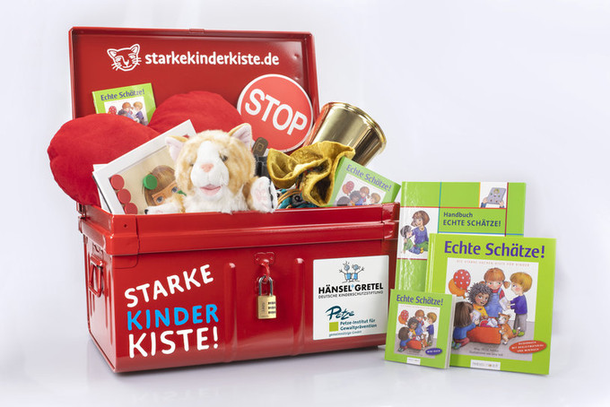

Die STARKE KINDER KISTE! Das ECHTE SCHÄTZE! Präventionsprogramm ist ein Projekt der Stiftung Hänsel+Gretel in Kooperation mit dem PETZE Institut, für den Schutz vor sexuellem Missbrauch für KITA-Kinder in Deutschland. Das Kinderschutz-Zentrum Leipzig ist Partnerin in der Region Leipzig.

## Worum geht es im Projekt?
Dieses Präventionsprojekt richtet sich an Kinder im Vorschulalter und deren Eltern. Vermittelt werden fünf zentrale Präventionsbotschaften gegen sexuellen Missbrauch.

Mit der "STARKE KINDER KISTE!" werden Kinder spielerisch und mit viel Freude am Entdecken des eigenen Körpers mit den eigenen Grenzen und Gefühlen vertraut und sprechfähig gemacht und gestärkt.

Den roten Faden des Projektes bildet das Kinderbuch "Echte Schätze", dort hilft die Katze Kim den Kindern in verschiedenen Situationen. Die Kiste bietet dazu wunderschöne und hochwertige  Materialen, wie ein großes rotes Herz-Kissen (über Gefühle reden) oder einen goldenen Sprech-Trichter (Hilfe holen).

## Welche Schritte zur Projektumsetzung sind notwendig und wo unterstützt Sie das Kinderschutz-Zentrum?
**Schritt 1:** 3 bis 5 Kitas schließen sich zu einem „KITA-Verbund“ zusammen und bewerben sich gemeinsam für eine gesponserte "STARKE KINDER KISTE!" oder sorgen selbst für die Finanzierung der Kiste (2 100€). Kitas können vom selben Träger stammen oder z.B. auch im gleichen Sozialraum liegen.

**Schritt 2:** Schulung der Kita-Fachkräfte durch das Kinderschutz-Zentrum. In dieser 6h Schulung gibt es allgemeine Informationen zu Prävention und Intervention, Sexueller Gewalt gegen Kinder und eine Einführung in die Arbeit mit der Kiste. Diese Schulung befähigt Sie das Programm im Anschluss mit den Kinder durchzuführen. Die Kosten betragen 400€, wovon Sie sich 150€ von der Kinderschutzstiftung Hänsel + Gretel rückerstatten lassen können.

**Schritt 3:** Durchführung des Projektes. Beim dazugehörigen Elternabend kann das Kinderschutz-Zentrum ebenfalls unterstützen (kostenfrei). Das Projekt wird in 5-10 Wochen durchgeführt, dabei werden die 5 Präventionsbotschaften in Einheiten von 1-2h an vier Tagen bearbeitet.

**Schritt 4:** Für regelmäßige Durchführung sorgen, um den Präventionsgedanken im Kitaalltag zu verankern.

Ausführlichere Informationen erhalten Sie auf: [www.haensel-gretel.de](https://haensel-gretel.de/projekte/starke-kinder-kiste)

Flyer ["STARKE KINDER KISTE!"](/downloads/SKK_Flyer_web.pdf)

Sie können die "STARKE KINDER KISTE!" im Kinderschutz-Zentrum in der Südvorstadt besichtigen bei einem Informationstermin mit Fr. Pasch.

