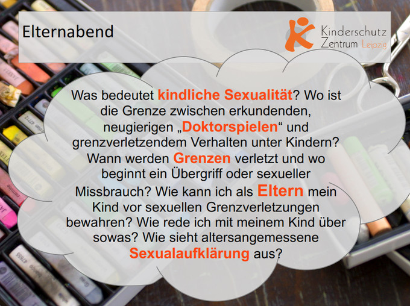

## Schwerpunkte des Elternabends

Wenn Kinder lernen sollen, auf ihre (körperlichen) Grenzen zu achten und diese zu schützen, braucht es ein Umfeld, das sie dabei unterstützt und diese Entwicklung akzeptiert. Nur wenn Erwachsene im Umfeld sensibilisiert sind und Verantwortung für den Schutz der Kinder übernehmen, können Präventionsprojekte mit den Kindern langfristige Effekte haben.

Ein Elternabend kann in diesem Zusammenhang als „Startschuss“ für ein bereits geplantes Präventionsprojekt dienen oder auch eine dauerhafte Zusammenarbeit mit einer Einrichtung erst anregen. Auch als Abschluss zu einem stattgefundenen Projekt ist er denkbar oder als ein Element in einer Reihe thematischer Elternabende, die die Einrichtung regelmäßig veranstaltet.

Grundsätzlich muss man davon ausgehen, dass man es auch mit Eltern zu tun hat, die selbst betroffen sind (als Opfer oder Täter), mit besorgten Eltern, die befürchten das Thema könnte Kindern Angst machen und Eltern, die Sexualität und sexualisierte Gewalt anders wahrnehmen, bewerten und stärker tabuisieren. Hier braucht es eine gute Absprache mit der jeweiligen Einrichtung und eine klare gemeinsame Haltung.

Schwerpunkte Kita und Grundschule: Kindliche Sexualität, was sind "normale" Verhaltensweisen und wo beginnen Grenzverletzungen unter Kindern? Was ist altersangemessen?

Schwerpunkte weiterführende Schulen: Die Rechte auf sexuelle Selbstbestimmung, Was ist ab wann erlaubt und wo darf oder muss ich mich als Eltern einmischen?

**Ziele:**

- Aufklärung und Information über sexualisierte Gewalt, Rechte von Kindern und Jugendliche, sowie Hilfsmöglichkeiten
- Abbau von Tabus im Zusammenhang mit dem Thema Sexualität und sexualisierter Gewalt
- Förderung einer körper- und sexualfreundlichen, wertschätzenden, grenzachtenden Erziehungshaltung
- Kennenlernen von Handlungsmöglichkeiten, Kinder in Situationen grenzverletzenden Verhaltens zu unterstützen
- Bekanntmachen von Hilfs- und Unterstützungsangeboten in Leipzig und online
- Kennenlernen der Personen, die mit ihren Kindern arbeiten (bei Kombiprojekt)

**Umfang:** Wir kommen für 1,5 bis 2 Stunden in Ihre Einrichtung.

Montag bis Donnerstag, z. B. von 17.30 - 19.00 Uhr gerne an einem Tag, an dem ohnehin schon ein Klassen/Gruppen-Elternabend ist (dann müssen die Eltern nicht zweimal zur Einrichtung kommen).

Je mehr Eltern anwesend sind, desto mehr wird der Elternabend im Vortragmodus stattfinden, kleine Gruppen ermöglichen eher ein gemeinsames Gespräch.

Auf Wunsch kann auch ein Vorgespräch im Kinderschutz-Zentrum oder per Telefon stattfinden. Spätestens zwei Wochen vor dem Elternabend bekommen Sie von uns einen Aushang oder Elternbrief zur Einladung und Bekanntmachung.

**Methodik:** Neben einem Vortrag zu grundlegenden Informationen über kindliche Sexualität, sexuellen Missbrauch und allgemeinen Präventions- und Interventionsmaßnahmen nehmen wir uns Zeit, auf Fragen und Sorgen der Eltern einzugehen. Wir besprechen in Kleingruppen und im Plenum erzieherische Möglichkeiten der Prävention sexuellen Missbrauchs und diskutieren Vorgehensweisen für den Fall einer Vermutung oder einer tatsächlich stattgefundenen sexuellen Grenzverletzung.

**Kosten:** Die Kosten sind bereits durch die Finanzierung der Stadt Leipzig abgedeckt.

**Verfügbarkeit:** Eine Umsetzung bedarf mindestens 3 Wochen Vorlauf.

**Sonstiges:** Benötigt wird ein passender Raum, z.B. Aula oder ähnliches, Beamer und Leinwand müssen vorhanden sei, gerne auch ein Laptop. Außerdem ein Tisch auf dem Bücher und Broschüren und ggf. Arbeitsergebnisse der Kinder ausliegen können.

## Wie wir arbeiten - Ein Beispiel

*Das Titelbild der Power-Point-Präsentation für den Elternabend in der Kita.*
