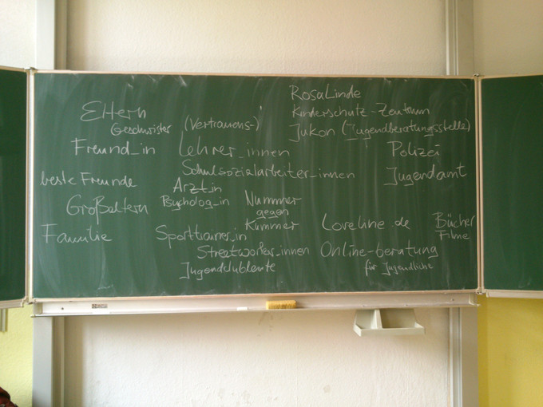

## Schwerpunkte der Projekte

In der Arbeit mit den Schülern der weiterführenden Schulen - Oberschule, Gesamtschule, Gymnasium, Förderschule widmen wir uns folgenden Themen:

- Mein Körper gehört mir - das Recht auf körperliche Selbstbestimmung
- Grenzen - Wie erkenne ich meine eigenen und die der anderen?
- Sexuelle Rechte - Welche sind das? Wer ist für deren Umsetzung verantwortlich?
- Altersschutzgrenzen des StGB - Wer darf mit wem? Was ist verboten? Was bedeutet das?
- Selbst wenn ich dürfe - will ich das? Was ist für mich in Beziehungen ok und was nicht?
- Hilfe suchen und Hilfe finden für Jugendliche

Mit zunehmender Reife der Kinder widmen wir uns vor allem der Thematik jugendlichen Sexualverhaltens, da in dieser Altersgruppe Grenzverletzungen und Übergriffe von Gleichaltrigen und in Beziehungen eine größere Rolle spielen. Dabei reflektieren wir anhand von Beispielen auch Grenzverletzungen auf digitalem Wege, Peer-Group-Dynamiken und den Einfluss von Geschlechterrollenstereotypen.

Die Begleitung der Stunden durch die Klassenlehrkraft ist erwünscht und diese wird auch gern von uns in die Gespräche mit eingebunden.

## Sexuelle Rechte und Grenzverletzungen - Projekttag
**Umfang**: Für dieses Projekt kommen wir im Frau-Mann-Team für sechs Schulstunden in die Klassenstufe 6.

Wir bieten ebenso einen passenden 1-1,5 stündiger Elternabend an. (siehe auch [Angebote für Eltern](/angebote/praevention-fuer-eltern/))

**Methodik**: Wir arbeiten mit Übungen, Arbeitsblättern und vor allem im freien Unterrichtsgespräch.

**Kosten**: Es fallen Materialkosten von 2€ pro Schüler\_in an. Diese können per Quittung oder Rechnung bezahlt werden.

**Verfügbarkeit**: Melden Sie sich ab Juni für Projekte im darauffolgenden Schuljahr

**Sonstiges**: Für einige Projektstunden benötigen wir zwei Räume zum Arbeiten in getrennten Gruppen. Die Projekte werden inhaltlich und methodisch auf die jeweiligen Schulformen angepasst.

## Wie wir arbeiten - Ein Beispiel

Am Ende des Projektes haben wir das Thema mit den Jugendlichen gerade erst angefangen zu besprechen - es arbeitet in den Köpfen weiter. Daher ist es uns wichtig zum Abschluss des Projektes auf das Thema Hilfe einzugehen. Wo können Jugendliche in verschiedenen Situationen Hilfe oder Informationen bekommen? Dabei ermutigen wir sie nicht nur dazu, dies überhaupt zu tun - denn jeder braucht mal Hilfe - sondern auch solange nach Hilfe zu suchen, bis sie welche gefunden haben.

Dazu bringen wir diverse Beispielfälle mit und überlegen gemeinsam, welche Anlaufstellen den Schüler\_innen dazu einfallen. Die Antworten sammeln wir als Tafelbild. Anschließend sollen die Jugendlichen die für sie relvanten Hilfepunkte in ein eigenes Hilfenetz eintragen.

*Dieses Tafelbild mit möglichen Anlaufstellen für Hilfe und Information entstand in der 6. Klasse einer Leipziger Oberschule.*
